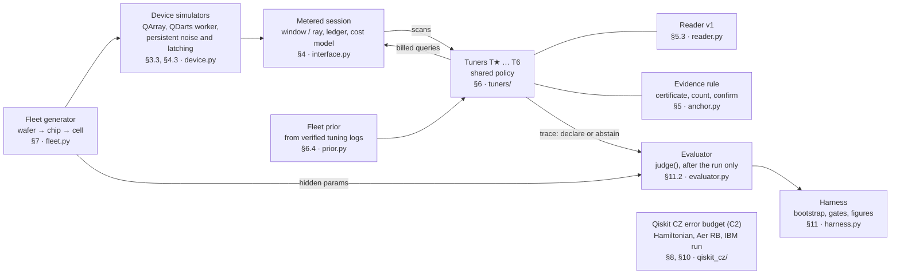

# SpinTune v5: Design Document

**A benchmark and a reference tuner for charge tuning of CMOS spin-qubit cells: does chip history make tuning cheaper without more wrong charge declarations?**

| | |
|---|---|
| **Event** | Equal1 × Fsas "Compute the Future", Timișoara HPC Hackathon (InnoWeek 2026). Idea-only pitch Tue 27 Oct 2026; final Fri 27 Nov 2026 at Qiskit Fall Fest |
| **Team** | Duo, 20+ h/week each through November (~180 focused hours). Laptops (Apple M4 Pro, 14 cores) |
| **Judging constraints** | Visible Qiskit use is required. HPC use is optional |
| **Version** | v5, 25 Oct 2026. Changes from v4: the shortcut and native-count baselines run on the stress set ([§12](12-compute-plan.md), B4); the G0 branch uses the lower CI bound of both h and h_t ([§11.4](11-success-measurement.md#114-gates-thresholds-frozen-at-the-tagged-commit)); one primary C1 pass condition ([§11.4](11-success-measurement.md#114-gates-thresholds-frozen-at-the-tagged-commit)); T6's reliability gap to T2 is reported; the cascade check for T6's wrong declarations ([§11.5](11-success-measurement.md#115-statistics)); hold success over 10 s ([§11.2](11-success-measurement.md#112-success-for-one-cell)); persistent latching corrected to Γ_B ≤ 10² s⁻¹ ([§4.3](04-measurement-interface.md#43-simulation-behind-the-interface-design-call)); a week-1 fallback deliverable (B2). Added 26 Oct: [§18](18-scaling.md), scaling |
| **Related documents** | Feasibility reviews (`FEASIBILITY_REVIEW*.md`, `CROSS_REVIEW.md`); evidence scripts (`checks/README.md`) |
| **Source of truth** | This document: *what and why*. `bobi_resources/PLAN.md`: the task checklist, to be rebuilt from [§15.3](15-plan.md#153-tasks-needs--hard-dependencies-done--the-check-that-must-pass). `bobi_resources/SPINTUNE-2.md`: pitch notes, to be updated per [§15.1](15-plan.md#151-before-the-pitch-tue-27-oct-idea-only) |
| **Status** | Design. Feasibility checks only (scripts in `checks/`, [§1.2](01-design-decisions-and-evidence.md#12-evidence-status-25-oct-2026)). No tuner has been built. Every number from `checks/` is an idealized estimate (noiseless cells, perfect reader, one specified policy), not a result. Every target is a hypothesis, frozen before the test fleet is generated ([§11.6](11-success-measurement.md#116-pre-registration)) |

Tags used throughout:
- **[measured]**: we ran it; the script is in `checks/`.
- **[sourced]**: published, with a link.
- **[inferred]**: our reading of a source that doesn't state it outright.
- **[assumed]**: our assumption, always swept.
- **[design call]**: a choice made in this document, which the team can override.

## How this folder is organised

The v5 design document, split into one file per section. Section numbers are unchanged, so a reference such as §5.1 in `checks/README.md` or the reviews still points at the same content. Inside these files every § reference is a link.

## System at a glance

Tuners never see a device's parameters: they act only through the metered session, and only the evaluator reads ground truth, after the run. Module names are from [Appendix A](appendix-a-interfaces-and-code-layout.md).

## Parts

### Overview

Why the project exists, what it decides, and what counts as success.

| § | Part | What it covers |
|---|---|---|
| 0 | [0. Pitch](00-pitch.md) | The pitch, what has been measured so far, what changes if it works, and what it does not claim. |
| 1 | [1. Design decisions and evidence](01-design-decisions-and-evidence.md) | The 18 design calls this document makes, and the evidence-status table behind every *[measured]* claim. |
| 2 | [2. Goals, non-goals, anti-goals](02-goals-non-goals-anti-goals.md) | Goals C1–C4 and the protected outcome, related work, and the benchmark scoring contract. |

### System components

The pieces that get built: the device and its simulators, the interface tuners act through, the evidence rule and reader, the tuners, the fleet they run on, and the code-level interfaces.

| § | Part | What it covers |
|---|---|---|
| 3 | [3. Scope and device template](03-scope-and-device-template.md) | The 22FDX SEB-sensed double dot, what "a chip" means, the simulators (QArray, QDarts), deferred work. |
| 4 | [4. The measurement interface (the only view of a device)](04-measurement-interface.md) | The only view a tuner has of a device: windows and rays, budget, the cost model (pixels vs time), the simulation behind the session. |
| 5 | [5. Reading the device: certificate, count, confirm](05-reading-the-device.md) | The anchor certificate (evidence rule), confirmation and declaration, the reader contract, oracle-assisted mode. |
| 6 | [6. Tuners and baselines](06-tuners-and-baselines.md) | The shared descent policy, tuners T★–T6, the comparisons, and how histories and tuning logs are used. |
| 7 | [7. The fleet](07-fleet.md) | The wafer → chip → cell generator, parameter defaults and sweeps, charge noise, the fleets, external real-device data. |
| 9 | [9. Drift (stretch, C3, first to cut)](09-drift.md) | Drift injection, monitoring, detection and local re-tune (C3, stretch, first to cut). |
| A | [Appendix A. Interfaces and code layout](appendix-a-interfaces-and-code-layout.md) | Data types, the session API, file formats and the module map of the `spintune/` package. |

### Physics and quantum layer (C2)

The Qiskit study, protected because visible Qiskit use is required.

| § | Part | What it covers |
|---|---|---|
| 8 | [8. Physics layer: the Qiskit CZ error-budget study (C2)](08-physics-layer-cz-error-budget.md) | The CZ gate model from the device Hamiltonian, noise composed as channels, and the error-budget study (C2). |
| 10 | [10. Quantum layer: what Qiskit does, and what the course materials give us](10-quantum-layer-qiskit.md) | What Qiskit does: model-based CZ and RB, the IBM hardware run, course content deliberately not used. |

### Evaluation

How results are scored, gated and computed, and how they hold up at scale.

| § | Part | What it covers |
|---|---|---|
| 11 | [11. How success is measured (frozen before the test fleet runs)](11-success-measurement.md) | Per-cell success, the scorecard, gates G0–G5, statistics and pre-registration. |
| 12 | [12. Compute plan](12-compute-plan.md) | Run counts and core-hours per job, and how runs are parallelised. |
| 18 | [18. Scaling: more cells, more dots](18-scaling.md) | What scales to more cells and more dots per cell, and what doesn't: cost, history, compounding wrong declarations, the limits of the two-dot evidence rule. |

### Delivery

What we need, what we ask, how the work is scheduled, and what can go wrong.

| § | Part | What it covers |
|---|---|---|
| 13 | [13. Prerequisites, and which we can get ourselves](13-prerequisites.md) | What the project needs and whether we can get it ourselves. |
| 14 | [14. Questions for Equal1 (most important first)](14-questions-for-equal1.md) | Twelve questions for Equal1, most important first, including the structured data request. |
| 15 | [15. Plan](15-plan.md) | Pitch prep, tracks and hour caps, tasks A0–F4, schedule, critical path, cut order, demo. |
| 16 | [16. Risks](16-risks.md) | Risks with severity and mitigation. |

### Reference

| § | Part | What it covers |
|---|---|---|
| 17 | [17. References](17-references.md) | Sources by topic. |

## Full contents

Every section and subsection

- [0. Pitch](00-pitch.md)
  - [If it works: what changes](00-pitch.md#if-it-works-what-changes)
- [1. Design decisions and evidence](01-design-decisions-and-evidence.md)
  - [1.1 Decisions this document makes [design calls; confirm or override]](01-design-decisions-and-evidence.md#11-decisions-this-document-makes-design-calls-confirm-or-override)
  - [1.2 Evidence status (25 Oct 2026)](01-design-decisions-and-evidence.md#12-evidence-status-25-oct-2026)
- [2. Goals, non-goals, anti-goals](02-goals-non-goals-anti-goals.md)
  - [2.1 Related work, and what is new here](02-goals-non-goals-anti-goals.md#21-related-work-and-what-is-new-here)
  - [2.2 Benchmark scoring contract [design call]](02-goals-non-goals-anti-goals.md#22-benchmark-scoring-contract-design-call)
- [3. Scope and device template](03-scope-and-device-template.md)
  - [3.1 Primary device: a 22FDX SEB-sensed double dot, modelled on Equal1's cells](03-scope-and-device-template.md#31-primary-device-a-22fdx-seb-sensed-double-dot-modelled-on-equal1s-cells)
  - [3.2 What "a chip" means here](03-scope-and-device-template.md#32-what-a-chip-means-here)
  - [3.3 Simulators](03-scope-and-device-template.md#33-simulators)
  - [3.4 Deferred and stretch](03-scope-and-device-template.md#34-deferred-and-stretch)
- [4. The measurement interface (the only view of a device)](04-measurement-interface.md)
  - [4.1 Queries [design call]](04-measurement-interface.md#41-queries-design-call)
  - [4.2 Cost model (pixels are not time)](04-measurement-interface.md#42-cost-model-pixels-are-not-time)
  - [4.3 Simulation behind the interface [design call]](04-measurement-interface.md#43-simulation-behind-the-interface-design-call)
- [5. Reading the device: certificate, count, confirm](05-reading-the-device.md)
  - [5.1 The anchor certificate [design call]](05-reading-the-device.md#51-the-anchor-certificate-design-call)
  - [5.2 Confirmation and declaration](05-reading-the-device.md#52-confirmation-and-declaration)
  - [5.3 Reader contract [design call]](05-reading-the-device.md#53-reader-contract-design-call)
  - [5.4 Oracle-assisted development mode](05-reading-the-device.md#54-oracle-assisted-development-mode)
- [6. Tuners and baselines](06-tuners-and-baselines.md)
  - [6.1 The shared policy: diagonal descent, then axis rays [design call]](06-tuners-and-baselines.md#61-the-shared-policy-diagonal-descent-then-axis-rays-design-call)
  - [6.2 Tuners](06-tuners-and-baselines.md#62-tuners)
  - [6.3 Comparisons (each one answers a different question)](06-tuners-and-baselines.md#63-comparisons-each-one-answers-a-different-question)
  - [6.4 Histories and tuning logs](06-tuners-and-baselines.md#64-histories-and-tuning-logs)
- [7. The fleet](07-fleet.md)
  - [7.1 Structure [design call]](07-fleet.md#71-structure-design-call)
  - [7.2 Parameters (defaults and sweep ranges)](07-fleet.md#72-parameters-defaults-and-sweep-ranges)
  - [7.3 Charge noise as seen by the gates](07-fleet.md#73-charge-noise-as-seen-by-the-gates)
  - [7.4 Fleets](07-fleet.md#74-fleets)
  - [7.5 Tuning logs](07-fleet.md#75-tuning-logs)
  - [7.6 External real-device data [sourced; none is 22FDX]](07-fleet.md#76-external-real-device-data-sourced-none-is-22fdx)
- [8. Physics layer: the Qiskit CZ error-budget study (C2)](08-physics-layer-cz-error-budget.md)
  - [8.1 Conventions [design call]](08-physics-layer-cz-error-budget.md#81-conventions-design-call)
  - [8.2 CZ gate model [measured checks]](08-physics-layer-cz-error-budget.md#82-cz-gate-model-measured-checks)
  - [8.3 Noise and error-budget components](08-physics-layer-cz-error-budget.md#83-noise-and-error-budget-components)
  - [8.4 Why the tuner doesn't estimate these parameters](08-physics-layer-cz-error-budget.md#84-why-the-tuner-doesnt-estimate-these-parameters)
  - [8.5 The study and its expected outcome](08-physics-layer-cz-error-budget.md#85-the-study-and-its-expected-outcome)
- [9. Drift (stretch, C3, first to cut)](09-drift.md)
- [10. Quantum layer: what Qiskit does, and what the course materials give us](10-quantum-layer-qiskit.md)
  - [10.1 Model-based CZ and RB (C2)](10-quantum-layer-qiskit.md#101-model-based-cz-and-rb-c2)
  - [10.2 IBM hardware run (a scheduled demonstration with a fallback)](10-quantum-layer-qiskit.md#102-ibm-hardware-run-a-scheduled-demonstration-with-a-fallback)
  - [10.3 Course content deliberately not used](10-quantum-layer-qiskit.md#103-course-content-deliberately-not-used)
  - [10.4 Pitch framing from the course](10-quantum-layer-qiskit.md#104-pitch-framing-from-the-course)
- [11. How success is measured (frozen before the test fleet runs)](11-success-measurement.md)
  - [11.1 Primary question](11-success-measurement.md#111-primary-question)
  - [11.2 Success for one cell](11-success-measurement.md#112-success-for-one-cell)
  - [11.3 Scorecard](11-success-measurement.md#113-scorecard)
  - [11.4 Gates (thresholds frozen at the tagged commit)](11-success-measurement.md#114-gates-thresholds-frozen-at-the-tagged-commit)
  - [11.5 Statistics](11-success-measurement.md#115-statistics)
  - [11.6 Pre-registration](11-success-measurement.md#116-pre-registration)
- [12. Compute plan](12-compute-plan.md)
- [13. Prerequisites, and which we can get ourselves](13-prerequisites.md)
- [14. Questions for Equal1 (most important first)](14-questions-for-equal1.md)
- [15. Plan](15-plan.md)
  - [15.1 Before the pitch (Tue 27 Oct, idea-only)](15-plan.md#151-before-the-pitch-tue-27-oct-idea-only)
  - [15.2 Tracks and hour caps [design call]](15-plan.md#152-tracks-and-hour-caps-design-call)
  - [15.3 Tasks ("Needs" = hard dependencies; "Done" = the check that must pass)](15-plan.md#153-tasks-needs--hard-dependencies-done--the-check-that-must-pass)
  - [15.4 Schedule](15-plan.md#154-schedule)
  - [15.5 Critical path](15-plan.md#155-critical-path)
  - [15.6 Cut order, and what is never cut](15-plan.md#156-cut-order-and-what-is-never-cut)
  - [15.7 Demo (27 Nov)](15-plan.md#157-demo-27-nov)
  - [15.8 Left to the builder](15-plan.md#158-left-to-the-builder)
- [16. Risks](16-risks.md)
- [17. References](17-references.md)
- [18. Scaling: more cells, more dots](18-scaling.md)
  - [18.1 More cells, chips and wafers](18-scaling.md#181-more-cells-chips-and-wafers)
  - [18.2 More dots per cell](18-scaling.md#182-more-dots-per-cell)
  - [18.3 The Qiskit layer](18-scaling.md#183-the-qiskit-layer)
  - [18.4 What we can and can't claim](18-scaling.md#184-what-we-can-and-cant-claim)
- [Appendix A. Interfaces and code layout](appendix-a-interfaces-and-code-layout.md)

